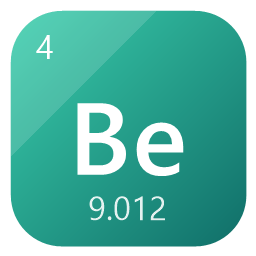
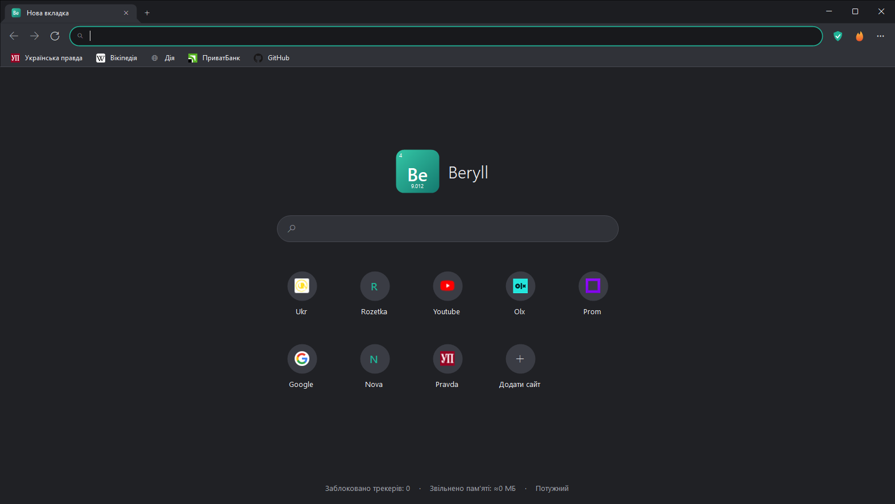
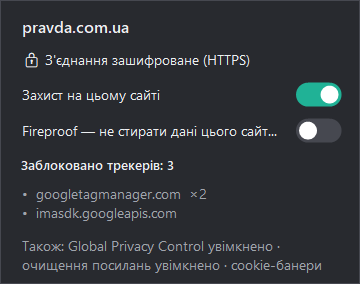
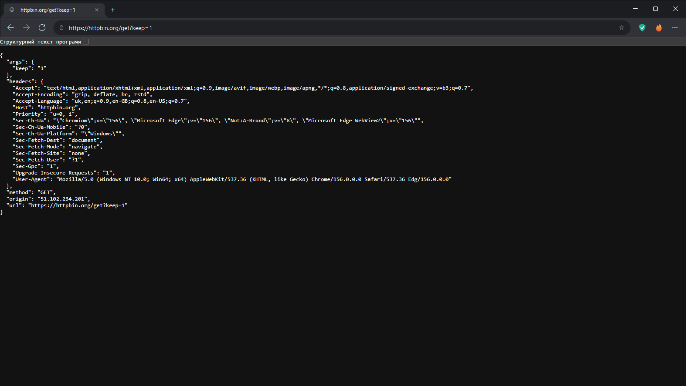

<div align="center">



# Beryll Browser

**Швидкий приватний браузер для старих і слабких ПК на Windows 10 / 11**

Захист від стеження у стилі DuckDuckGo · самоадаптація під залізо · сплячі вкладки · open source (MIT)

<a href="https://github.com/ihorstefaniv/Beryllium-Browser/raw/main/download/Beryll-portable.zip">
  
</a>

<sub>Версія 1.0 · portable, без встановлення · ~0,4 МБ</sub>

</div>

---



## Навіщо

На старих ПК (Pentium / Celeron, 2–4 ГБ RAM, HDD) звичайний браузер перетворює роботу на очікування.
Beryll робить три речі:

1. **Не вантажить зайве** — вбудоване блокування трекерів і реклами (мінус десятки скриптів на сторінку).
2. **Не тримає в пам'яті непотрібне** — фонові вкладки «засинають» і повертають пам'ять Windows.
3. **Підлаштовується під конкретний ПК** — сам визначає RAM, тип диска, відеокарту й апаратні відеокодеки.

## Як запустити

1. Натисніть кнопку **«Завантажити»** вище.
2. Розпакуйте архів у будь-яку папку (наприклад, `C:\Програми\Beryll`).
3. Запустіть **`Beryll.exe`**.

Потрібен **Microsoft Edge WebView2 Runtime** — у Windows 11 і оновленій Windows 10 він уже є.
Якщо ні — Beryll сам запропонує сторінку завантаження (безкоштовно, від Microsoft).

> Portable-режим (усе на флешці): покладіть поруч із `Beryll.exe` порожній файл з назвою `portable`.

## Можливості

### Браузер, як Chrome, але легший
- Вкладки в заголовку вікна, адресний рядок з підказками, **панель закладок з іконками**.
- **Нова вкладка без веб-рушія (0 МБ)**: пошук і плитки частих сайтів з іконками — додати, змінити, прибрати.
- Імпорт закладок з Chrome / Edge / Brave / Opera, історія, відновлення сесії
  (після запуску вантажиться лише активна вкладка).
- Друк, PDF, завантаження, пошук на сторінці, масштаб, повний екран, збереження паролів.
- Світла / темна тема як у Windows.

### Захист у стилі DuckDuckGo
| | |
|---|---|
| 🛡 **Блокування трекерів** | сторонні рекламні й аналітичні сервіси; сайти тієї самої компанії не ламаються |
| 🔒 **HTTPS спершу** | `http://` відкривається як `https://`, з безпечним відкатом |
| 🔗 **Чисті посилання** | прибирає `utm_*`, `fbclid`, `gclid`, `yclid` та інші мітки стеження |
| ✋ **Global Privacy Control** | сайтам передається сигнал «не продавати мої дані» (`Sec-GPC: 1`) |
| 🍪 **Cookie-банери** | автоматично натискається «Відхилити» / «Лише необхідні» |
| 🔥 **Кнопка «Вогонь»** | закрити вкладки й стерти дані одним кліком; сайти **Fireproof** лишаються залогіненими |



Перевірка на httpbin.org: сервер отримав `https://`, адресу без `utm_source`/`fbclid` і заголовок `Sec-Gpc: 1`:



### Самоадаптивна швидкість
- Профіль ПК: **≤ 2 ГБ / ≤ 4 ГБ / ≤ 8 ГБ / потужний** → скільки вкладок тримати живими і коли присипляти.
- **Диспетчер пам'яті**: фонові вкладки → низький пріоритет → «заморозка» → **сон** (пам'ять повертається Windows).
  Не чіпає закріплені вкладки, вкладки зі звуком і **вкладки з незбереженим текстом у формах**.
  Замір: 4 вкладки — 720 МБ, після сну фонових — 490 МБ.
- Без апаратного декодування VP9 сайти отримують відео **H.264** — YouTube не «вантажить» процесор.
- «Легкий режим» на слабких ПК, **Діагностика** з порадами (наприклад, «SSD прискорить запуск у кілька разів»).

## Гарячі клавіші
`Ctrl+T` нова вкладка · `Ctrl+W` закрити · `Ctrl+Shift+T` відновити · `Ctrl+Tab`, `Ctrl+1…9` перемикання ·
`Ctrl+L` адреса · `F5` оновити · `Alt+←/→` назад / вперед · `Ctrl+D` закладка · `Ctrl+Shift+B` панель закладок ·
`Ctrl+H` історія · `Ctrl+J` завантаження · `Ctrl+F` пошук · `Ctrl+P` друк · `Ctrl+Shift+Del` вогонь · `F11` повний екран

## Обмеження версії 1.0
- Розширення браузера ще не підтримуються → КЕП через апаратний токен може не працювати
  (файлові ключі й хмарні КЕП, зокрема Дія.Підпис, працюють). Розширення — у плані 1.1.
- Немає синхронізації, перекладу сторінок, кількох вікон; сам Beryll поки оновлюється вручну
  (рушій оновлює Microsoft разом із Windows).
- Exe не має цифрового підпису — SmartScreen може попередити при першому запуску.

## Збірка з коду
```
powershell -ExecutionPolicy Bypass -File build.ps1
```
Нічого встановлювати не треба: використовується компілятор C#, що є в Windows.
SDK WebView2 (BSD) лежить у `lib\`. Результат — `dist\Beryll\` і `dist\Beryll-portable.zip`.

## Ліцензія
MIT — див. [LICENSE](LICENSE). Файли Microsoft WebView2 SDK — за їхньою ліцензією (`lib/WebView2-LICENSE.txt`).

<div align="center"><sub>Ihor Stefaniv with AI Claude</sub></div>
